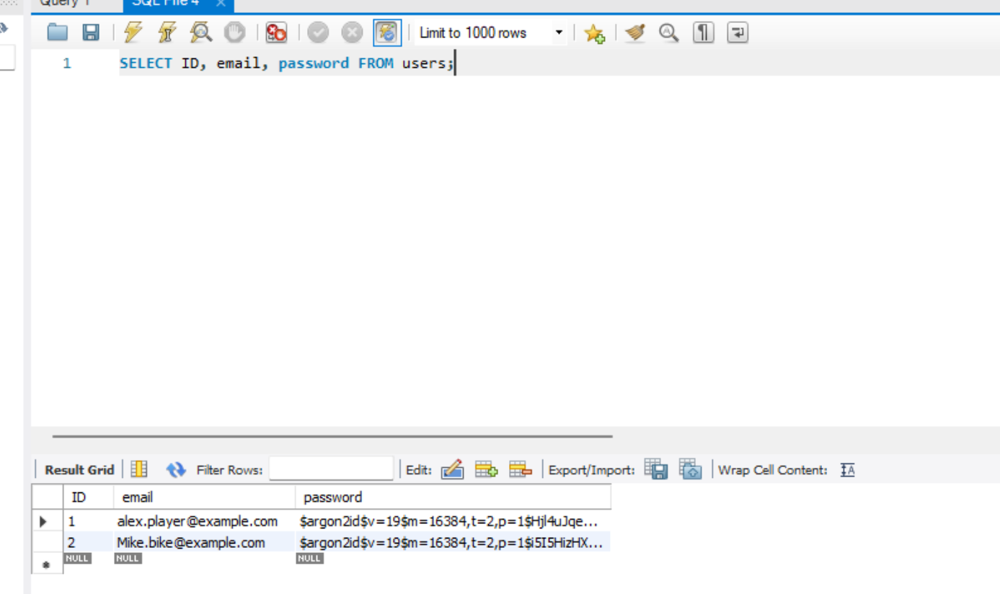

SCHEMA SETUP

database name: gameflix_database

CREATE TABLE users (
ID BIGINT not null AUTO_INCREMENT,
first_name varchar(100) NOT NULL,
last_name varchar(100) NOT NULL,
email varchar(255) NOT NULL,
username varchar(50) NOT NULL,
password varchar(255) NOT NULL,
UNIQUE (ID),
UNIQUE (email)
);

The email and the ID must both be unique values here. One of the strange things that was
encountered was that by default the jpa was converting my firstName into first_name. I elected to 
change the name in mysql since that was the easier option. 

Image of screenshot of mysql table showing the users and their email and hashed passwords.

As can be observed here, I've opted for using Argon2 for the encryption. This decision was based
on brief research, that shows Argon2 to be the industry standard for encryption. The most impressive
aspect of Argon2 was its 'memory hardness', which forces an attempted brute-forcer to consume huge
amounts of RAM to attempt a password guess, versus encryption like bcrypt.

As far as the timeout for the login, I estimated 1 hour to be an adequate amount of time to remain logged in.
I could consider more time for a gaming app, depending if the gaming is streamed directly, or if it exists
locally for the user, and logging in is just for account maintenance and purchases. 

The choice of ddl-auto: validate seemed like the most practical, since it would appear what would be most likely used
in a production environment. While I did initially set up my program, and use ddl-auto: update, I realized since I wanted
to implement factors into my schema, such as the UNIQUE contraints on username and email, manually creating the schema
and connecting it with :validate seemed the best choice. It did cause me to encounter the aformentioned issue with the
database naming conventions.

Module 3 changes: Instead of logging in with a username and password, I've chosen to use the email and password.
This is mainly due to the fact that the lesson had a strong emphasis on the unique email, which lead me to consider
it to be the better validator. While I did impose a Unique constraint on the username as well, this would likely
be mainly utilized in the 'game' itself, when users try to locate other users.
I did not implement MFA. Since I got to this project late, I did not have the time to make it  more complex than
the minimal requirements of the assignment allowed. 

images for the testing are in the docx file in this repository, json_responses_login_reg.docx

AI was used extensively, especially in generating a lot of the boilerplate code. It was also used to assist in validating
that all proper packages were imported, as I was troubleshooting various issues. I had some trouble understanding
the utilization of jwt, and setting up the Spring Security to allow unauthenticated traffic to pass through. Finally, Postman
has a good tool for generating mass numbers of json requests for endpoint testing. Some of the issues I had with utilizing AI
was odd formatting errors, and incorrect calling of packages in the code, specifically with the argon2 spring packages.
While others occurred, this one immediately comes to mind. using the springboot debug, I was able to validate that the jwt
was being properly authenticated. I also was able to confirm that modifying the tokens did cause them to be rejected. I was
wary especially due to the warning, that the jwt would not see proper authentication. 